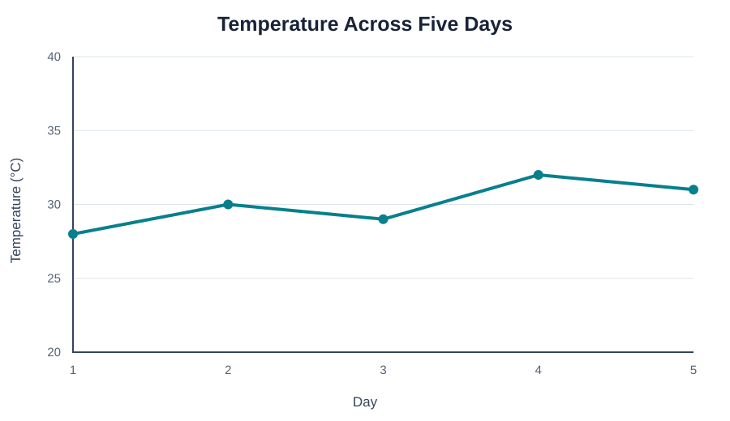

# 02 — Matplotlib Fundamentals

> **Goal:** Create a basic plot, understand the Figure and Axes objects, and customize labels, limits, grids and legends.

## 1. What is Matplotlib?

Matplotlib is a Python plotting library used to create static, animated and interactive visualizations. Its `pyplot` interface provides convenient functions for common plotting tasks.

```python
import matplotlib.pyplot as plt
```

## 2. Your first line plot

```python
import matplotlib.pyplot as plt

days = [1, 2, 3, 4, 5]
temperature = [28, 30, 29, 32, 31]

plt.plot(days, temperature)
plt.show()
```

**Visual output preview — example 2**



**What to notice:** Follow the line from left to right to see how the value changes across the ordered x-axis.

The x-values represent days and the y-values represent temperature. Matplotlib draws points and connects them with lines.

## 3. Add title and axis labels

```python
plt.plot(days, temperature)
plt.title("Temperature Across Five Days")
plt.xlabel("Day")
plt.ylabel("Temperature (°C)")
plt.grid(True)
plt.show()
```

**Visual output preview — example 3**


**What to notice:** Follow the line from left to right to see how the value changes across the ordered x-axis.

Labels tell the viewer what the axes mean. Always include units when they are relevant.

## 4. Figure and Axes — the core mental model

- **Figure:** the complete canvas or window.
- **Axes:** one plotting area inside the Figure.
- **Axis:** the x or y scale and ticks within an Axes.

A Figure can contain multiple Axes. The object-oriented interface gives explicit control:

```python
fig, ax = plt.subplots(figsize=(7, 4))
ax.plot(days, temperature, marker="o", label="Temperature")
ax.set_title("Temperature Across Five Days")
ax.set_xlabel("Day")
ax.set_ylabel("Temperature (°C)")
ax.grid(True)
ax.legend()
plt.show()
```

**Visual output preview — example 4**


**What to notice:** Follow the line from left to right to see how the value changes across the ordered x-axis.

For larger projects, prefer the object-oriented style because each Axes can be customized independently.

## 5. Change line appearance

```python
fig, ax = plt.subplots()
ax.plot(
    days,
    temperature,
    color="teal",
    linestyle="--",
    linewidth=2,
    marker="o",
    markersize=6,
    label="Daily temperature"
)
ax.legend()
plt.show()
```

**Visual output preview — example 5**


**What to notice:** Follow the line from left to right to see how the value changes across the ordered x-axis.

Common options:
- `color`: line color.
- `linestyle`: solid, dashed, dotted, etc.
- `linewidth`: line thickness.
- `marker`: marker symbol at data points.
- `markersize`: marker size.
- `label`: legend text.

## 6. Set limits and ticks

```python
ax.set_xlim(1, 5)
ax.set_ylim(20, 40)
ax.set_xticks([1, 2, 3, 4, 5])
```

**Visual output preview — example 6**


**What to notice:** This code customizes or saves the current line chart; the preview shows the resulting chart style.

Use limits carefully. A line chart may use a truncated scale for a specific reason, but make that choice clear. For bar charts, a zero baseline is usually important for honest comparison.

## 7. Add a legend

A legend explains what each plotted series represents:

```python
ax.plot(days, [28, 30, 29, 32, 31], label="City A")
ax.plot(days, [25, 27, 28, 29, 30], label="City B")
ax.legend()
```

**Visual output preview — example 7**


**What to notice:** Follow the line from left to right to see how the value changes across the ordered x-axis.

A legend requires labels on the plotted series.

## 8. Save a figure

```python
fig.savefig("temperature.png", dpi=300, bbox_inches="tight")
```

**Visual output preview — example 8**


**What to notice:** This code customizes or saves the current line chart; the preview shows the resulting chart style.

- `dpi`: resolution.
- `bbox_inches="tight"`: reduce unnecessary surrounding whitespace.

Save before closing the figure. Choose an appropriate format such as PNG, SVG or PDF depending on the intended use.

## 9. Pyplot versus object-oriented style

| Pyplot style | Object-oriented style |
|---|---|
| `plt.plot(...)` | `ax.plot(...)` |
| `plt.title(...)` | `ax.set_title(...)` |
| Convenient for quick plots | Better for multiple axes and reusable code |
| Uses current active axes | Explicitly targets a chosen Axes |

Both are valid. Learn the object-oriented style for control, and use pyplot for quick exploration.

## 10. Common mistakes

- Forgetting `plt.show()` in a normal script.
- Confusing Figure, Axes and Axis.
- Omitting units from labels.
- Creating a legend without labels.
- Saving the wrong or empty figure after creating multiple figures.
- Adding too many decorative elements that distract from the data.

## 11. Practice

Create a line plot of weekly study hours. Add a title, x/y labels, markers, grid, legend and save it as a high-resolution PNG.

**Checkpoint:** You should be able to explain what `fig` and `ax` represent in `fig, ax = plt.subplots()`.
