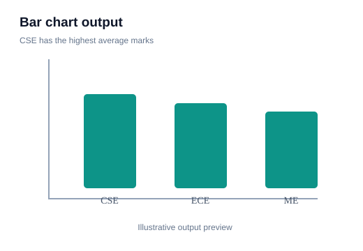
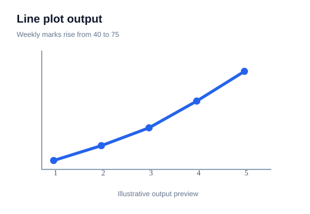

# 04 — Bar Plots and Count Plots

> **Goal:** Compare categories, distinguish precomputed summaries from raw observation counts, and choose the correct chart.

## 1. Bar plot — compare values across categories

A bar plot displays a numerical value for each category. The values may be totals, averages, percentages or another statistic.

```python
import matplotlib.pyplot as plt

departments = ["CSE", "ECE", "ISE"]
average_marks = [82, 76, 88]

fig, ax = plt.subplots()
ax.bar(departments, average_marks)
ax.set_title("Average Marks by Department")
ax.set_xlabel("Department")
ax.set_ylabel("Average Marks")
plt.show()
```

**Visual output preview — example 1**



**What to notice:** Compare bar heights across categories. Check what each bar measures: a count, total, average or other summary.

Each bar height represents a value already calculated for that category.

## 2. Horizontal bar chart

```python
fig, ax = plt.subplots()
ax.barh(departments, average_marks)
ax.set_xlabel("Average Marks")
ax.set_ylabel("Department")
plt.show()
```

**Visual output preview — example 2**


**What to notice:** Compare bar heights across categories. Check what each bar measures: a count, total, average or other summary.

Horizontal bars are useful when category labels are long.

## 3. Count plot — count raw observations

A count plot counts how many times each category appears in the raw data.

```python
import seaborn as sns
import pandas as pd
import matplotlib.pyplot as plt

df = pd.DataFrame({
    "Department": ["CSE", "ECE", "CSE", "ISE", "CSE", "ECE"]
})

sns.countplot(data=df, x="Department")
plt.title("Number of Students by Department")
plt.show()
```

**Visual output preview — example 3**


**What to notice:** Compare bar heights across categories. Check what each bar measures: a count, total, average or other summary.


**Visual output preview — example 3**



**What to notice:** Follow the line from left to right to see how the value changes across the ordered x-axis.

You do not need to calculate the counts first; Seaborn does that from the observations.

## 4. Bar plot versus count plot

| Bar plot | Count plot |
|---|---|
| Displays a supplied numerical value | Counts observations in each category |
| Often uses summarized data | Uses raw categorical observations |
| Example: average salary per department | Example: number of employees per department |

If you already have average marks, use a bar plot. If you have one row per student and want the number in each department, use a count plot.

## 5. Grouped bar chart

A grouped bar chart compares multiple series within each category.

```python
import numpy as np
import matplotlib.pyplot as plt

categories = ["CSE", "ECE", "ISE"]
year1 = [75, 70, 80]
year2 = [82, 76, 88]

x = np.arange(len(categories))
width = 0.35

fig, ax = plt.subplots()
ax.bar(x - width/2, year1, width, label="Year 1")
ax.bar(x + width/2, year2, width, label="Year 2")
ax.set_xticks(x, categories)
ax.set_ylabel("Average Marks")
ax.legend()
plt.show()
```

**Visual output preview — example 4**


**What to notice:** Compare bar heights across categories. Check what each bar measures: a count, total, average or other summary.

The small horizontal offsets place the two bars side by side.

## 6. Stacked bar chart

A stacked bar shows how subgroups contribute to a total:

```python
fig, ax = plt.subplots()
ax.bar(categories, year1, label="Year 1")
ax.bar(categories, year2, bottom=year1, label="Year 2")
ax.legend()
plt.show()
```

**Visual output preview — example 5**


**What to notice:** Compare bar heights across categories. Check what each bar measures: a count, total, average or other summary.

Stacked bars are useful for part-to-whole comparisons, but middle segments are harder to compare across categories because they do not share a common baseline.

## 7. Sort categories when useful

For ranking charts, sort categories by the value being displayed. This often makes the pattern easier to read.

Avoid sorting when the category order is meaningful, such as months or education levels.

## 8. Bar chart baseline

A bar's length encodes magnitude, so a zero baseline is usually important. A chart that starts the y-axis at 70 can make values 72 and 75 look dramatically different even though the actual difference is small.

For some non-bar charts, truncated axes can be appropriate if clearly labeled; bar charts require special care.

## 9. Common mistakes

- Using countplot when you already have summarized numeric values.
- Using barplot for raw observations when you want frequency counts.
- Forgetting the zero baseline.
- Showing too many categories in one chart.
- Stacking categories when precise comparison between segments is important.
- Not labeling what the bar height represents.

## 10. Practice

1. Create a bar chart of average marks by department.
2. Create a count plot from a raw student table.
3. Compare two years using grouped bars.
4. Show pass/fail counts with a stacked bar.
5. Explain why a count plot and bar plot answer different questions.

**Checkpoint:** Ask: “Do I have raw category observations, or do I already have a number for each category?” That decides count plot versus bar plot.
