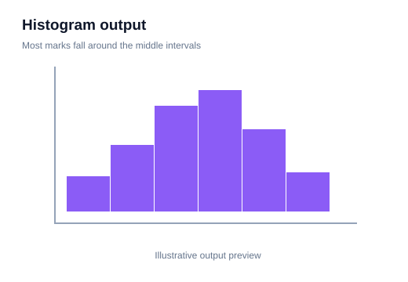

# 05 — Histograms and Distributions

> **Goal:** Understand how numerical data is distributed and how histogram bins affect what you see.

## 1. What is a distribution?

A distribution describes how values are spread. It can show:
- where values are concentrated,
- how wide the spread is,
- whether values are symmetric or skewed,
- whether there are multiple peaks,
- whether unusual observations exist.

For example, a list of exam marks tells you each student's score. A histogram helps you see how the scores are distributed across ranges.

## 2. What is a histogram?

A histogram groups numerical values into intervals called **bins** and displays the number of observations in each interval.

```python
import matplotlib.pyplot as plt

marks = [35, 40, 45, 50, 55, 60, 60, 65, 70, 75, 80, 85]

plt.hist(marks, bins=5, edgecolor="black")
plt.xlabel("Marks")
plt.ylabel("Frequency")
plt.title("Distribution of Exam Marks")
plt.show()
```

**Visual output preview — example 1**



**What to notice:** Bars show how many observations fall in each interval. Compare the shape, centre and spread.

- x-axis: value intervals.
- y-axis: frequency (count) by default.
- bars touch because the bins represent continuous intervals.

## 3. What are bins?

A bin is an interval that receives values within its boundaries. The number and width of bins affect the appearance of a histogram.

Too few bins can hide structure. Too many bins can make random variation look like meaningful patterns.

```python
plt.hist(marks, bins=3)
plt.show()

plt.hist(marks, bins=10)
plt.show()
```

**Visual output preview — example 2**


**What to notice:** Bars show how many observations fall in each interval. Compare the shape, centre and spread.

Compare both charts and notice how the visible detail changes.

## 4. Set explicit bin edges

```python
bins = [0, 20, 40, 60, 80, 100]
plt.hist(marks, bins=bins, edgecolor="black")
plt.show()
```

**Visual output preview — example 3**


**What to notice:** Bars show how many observations fall in each interval. Compare the shape, centre and spread.

Explicit edges are useful when intervals have real-world meaning, such as mark bands or age groups.

## 5. Frequency versus density

By default, histogram bar heights represent counts. With `density=True`, the histogram is normalized so the total area under the bars is 1.

```python
plt.hist(marks, bins=5, density=True)
plt.ylabel("Density")
plt.show()
```

**Visual output preview — example 4**


**What to notice:** Bars show how many observations fall in each interval. Compare the shape, centre and spread.

Density is not the same as raw count. It is useful when comparing distributions with different sample sizes.

## 6. Understand distribution shape

- **Symmetric:** left and right sides look similar.
- **Right-skewed:** long tail extends toward larger values.
- **Left-skewed:** long tail extends toward smaller values.
- **Unimodal:** one main peak.
- **Bimodal:** two main peaks.
- **Uniform-like:** values appear relatively evenly spread.

Do not label a distribution based on one bar. Consider the overall shape and sample size.

## 7. Histogram versus bar chart

| Histogram | Bar chart |
|---|---|
| Numerical continuous or measured data | Categories |
| Bins represent intervals | Bars represent named groups |
| Bars usually touch | Bars usually have gaps |
| Order follows numeric scale | Order can be chosen or meaningful |

## 8. Add a KDE curve with Seaborn

```python
import seaborn as sns
import pandas as pd

df = pd.DataFrame({"Marks": marks})
sns.histplot(data=df, x="Marks", bins=5, kde=True)
plt.show()
```

**Visual output preview — example 5**


**What to notice:** Bars show how many observations fall in each interval. Compare the shape, centre and spread.

KDE (kernel density estimation) creates a smoothed estimate of the distribution. It is a guide, not a direct count of observations, and can be misleading with very small samples or unsuitable bandwidths.

## 9. Common mistakes

- Using too few or too many bins.
- Confusing histogram with a category bar chart.
- Interpreting density as count.
- Comparing histograms with different bin edges without care.
- Assuming a smooth KDE curve represents the exact data distribution.

## 10. Practice

1. Plot a histogram of 100 exam marks.
2. Compare 5 bins and 20 bins.
3. Use explicit mark intervals from 0 to 100.
4. Plot a density histogram.
5. Identify whether a sample is symmetric, skewed or multimodal.

**Checkpoint:** A histogram answers “how are numerical values distributed?”, and bin choice controls the level of detail.
