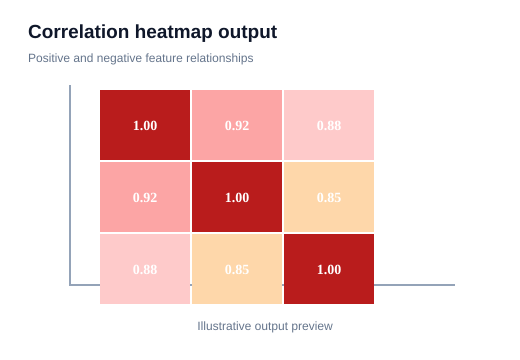
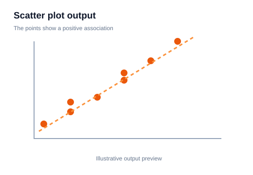

# 09 — Correlation and Heatmaps

> **Goal:** Explore relationships between numerical variables using correlation coefficients and heatmaps, while understanding their limitations.

## 1. What is correlation?

Correlation measures the strength and direction of association between two variables. A common measure is Pearson correlation, which focuses on a linear relationship.

The correlation coefficient (r) ranges from -1 to +1:
- +1: perfect positive linear relationship.
- 0: no linear correlation.
- -1: perfect negative linear relationship.

A correlation near zero does not rule out a nonlinear relationship.

## 2. Calculate correlation with Pandas

```python
import pandas as pd

df = pd.DataFrame({
    "Hours": [1, 2, 3, 4, 5],
    "Marks": [40, 50, 60, 70, 80],
    "Sleep": [8, 7, 7, 6, 6]
})

print(df.corr(numeric_only=True))
```

The result is a correlation matrix. The diagonal is 1 because each variable is perfectly correlated with itself.

## 3. Pearson, Spearman and Kendall

- **Pearson:** measures linear correlation using original values.
- **Spearman:** measures rank-based monotonic association.
- **Kendall:** rank-based association using concordant and discordant pairs.

```python
df.corr(method="pearson", numeric_only=True)
df.corr(method="spearman", numeric_only=True)
df.corr(method="kendall", numeric_only=True)
```

Choose the method based on the relationship and data, not just whichever produces the largest number.

## 4. Draw a heatmap

```python
import seaborn as sns
import matplotlib.pyplot as plt

corr = df.corr(numeric_only=True)
sns.heatmap(corr, annot=True, cmap="coolwarm", vmin=-1, vmax=1)
plt.title("Correlation Heatmap")
plt.show()
```

**Visual output preview — example 3**



**What to notice:** Notice how the colour intensity represents the value in each cell; read the annotations for exact values.

- `annot=True`: write values inside cells.
- `vmin` and `vmax`: set color scale limits.
- `cmap`: choose a color map.

A centered scale from -1 to +1 makes positive and negative relationships visually comparable.

## 5. Mask one half of a symmetric matrix

Correlation matrices are symmetric: corr(A, B) equals corr(B, A). To reduce duplicate information:

```python
import numpy as np

mask = np.triu(np.ones_like(corr, dtype=bool))
sns.heatmap(corr, mask=mask, annot=True, cmap="coolwarm", vmin=-1, vmax=1)
plt.show()
```

**Visual output preview — example 4**


**What to notice:** Notice how the colour intensity represents the value in each cell; read the annotations for exact values.

The mask hides the upper triangle including the diagonal.

## 6. Correlation does not mean causation

If two variables move together, that does not prove one causes the other. A third variable may influence both, or the association may be coincidental.

A strong correlation is a clue for further investigation, not a causal conclusion.

## 7. Outliers can change correlation

Pearson correlation can be strongly affected by outliers. Always inspect a scatter plot alongside a correlation value.

```python
sns.scatterplot(data=df, x="Hours", y="Marks")
plt.show()
```

**Visual output preview — example 5**



**What to notice:** Each point represents an observation. Look for direction, clusters, unusual points and curved patterns.

A single extreme observation can create or hide an apparent linear pattern.

## 8. Common mistakes

- Interpreting correlation as causation.
- Treating zero Pearson correlation as proof of no relationship.
- Forgetting that correlation is sensitive to outliers.
- Including ID columns in a correlation matrix without a reason.
- Comparing heatmaps with different color scales.
- Ignoring sample size and uncertainty.

## 9. Practice

1. Calculate a Pearson correlation matrix for numerical columns.
2. Draw an annotated heatmap with a fixed -1 to +1 scale.
3. Compare Pearson and Spearman correlation.
4. Draw scatter plots for the strongest positive and negative pairs.
5. Explain why correlation cannot establish causation.

**Checkpoint:** A heatmap helps reveal patterns, but inspect the underlying scatter plots before making a conclusion.
