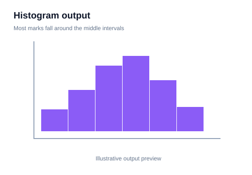
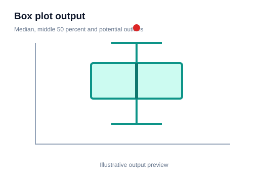
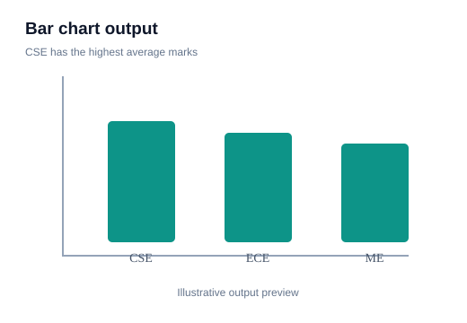
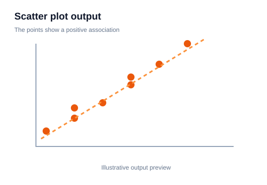

# 10 — Pair Plots and Exploratory Data Analysis (EDA)

> **Goal:** Explore a dataset systematically using summary tables and visualizations before building a model.

## 1. What is EDA?

**Exploratory Data Analysis (EDA)** is the process of inspecting and visualizing data to understand its structure, quality, distributions and relationships.

EDA helps answer:
- What variables are present?
- Which values are missing?
- Are there duplicates or unusual observations?
- How are numerical variables distributed?
- How are variables related?
- Are there patterns across categories?

EDA is not a single plot. It is a structured investigation.

## 2. Start with structure and quality

```python
import pandas as pd

df = pd.read_csv("data.csv")
print(df.head())
print(df.shape)
print(df.info())
print(df.describe(include="all"))
print(df.isna().sum())
print(df.duplicated().sum())
```

This reveals the size, dtypes, missing values, duplicates and summary statistics.

## 3. Univariate analysis

Univariate analysis studies one variable at a time.

For a numerical variable:
```python
import seaborn as sns
import matplotlib.pyplot as plt

sns.histplot(data=df, x="Age", kde=True)
plt.show()

sns.boxplot(data=df, x="Age")
plt.show()
```

**Visual output preview**



**What to notice:** Bars show the frequency or density in each interval. Notice the overall shape and where values are concentrated.

**Visual output preview**



**What to notice:** Compare the median and spread. Distant points can be possible outliers and should be investigated.

For a categorical variable:
```python
sns.countplot(data=df, x="Department")
plt.xticks(rotation=45)
plt.show()
```

**Visual output preview**



**What to notice:** Compare the category heights and check whether the chart shows counts or a summarized value.

## 4. Bivariate analysis

Bivariate analysis examines two variables:
- numerical + numerical: scatter plot,
- categorical + numerical: box plot or violin plot,
- categorical + categorical: count plot or crosstab heatmap.

```python
sns.scatterplot(data=df, x="StudyHours", y="Marks")
plt.show()

sns.boxplot(data=df, x="Department", y="Marks")
plt.show()
```

**Visual output preview**


**What to notice:** Compare the median and spread. Distant points can be possible outliers and should be investigated.

**Visual output preview**



**What to notice:** Each point is an observation. Look for direction, clusters, unusual points or a curved relationship.

## 5. Pair plot

A pair plot creates pairwise plots for several numerical columns. The diagonal usually shows each variable's distribution; off-diagonal cells show relationships between pairs.

```python
sns.pairplot(
    df,
    vars=["StudyHours", "Attendance", "Marks"],
    hue="Department"
)
plt.show()
```

**Visual output preview**


**What to notice:** A pair plot combines distributions and pairwise relationships across selected features. Use it to spot patterns between several variables.

- `vars`: choose numerical columns to compare.
- `hue`: color observations by a category.
- Pair plots can become expensive and cluttered when many columns or rows are included.

## 6. When pair plots are useful

They are useful for a first overview of a small number of numerical variables. Look for:
- positive or negative relationships,
- nonlinear patterns,
- clusters,
- unusual observations,
- different distributions across categories.

A pair plot is exploratory, not a substitute for detailed statistical analysis.

## 7. Missingness analysis

```python
missing_percent = df.isna().mean().mul(100).sort_values(ascending=False)
print(missing_percent)
```

This calculates the percentage of missing values per column. A bar plot can make it easier to compare columns with high missingness.

## 8. EDA workflow

1. Understand the question and data source.
2. Inspect shape, columns and dtypes.
3. Check missing values and duplicates.
4. Study numerical distributions.
5. Study category frequencies.
6. Explore important relationships.
7. Investigate outliers and data-quality issues.
8. Record findings and assumptions.
9. Plan cleaning and feature engineering.

## 9. Avoid EDA traps

- Looking for patterns until you find a random coincidence.
- Treating an outlier as an error without checking.
- Using the target in a way that leaks information into preprocessing.
- Ignoring data collection context.
- Assuming a plot proves a causal relationship.
- Generating pair plots for dozens of columns without a focused question.

## 10. Practice

Choose a tabular dataset and perform EDA:
1. Print structural summaries.
2. Plot distributions of three numeric columns.
3. Plot counts for two categorical columns.
4. Create a scatter plot for two related variables.
5. Create a pair plot for a small feature subset.
6. Write five observations and three data-quality concerns.

**Checkpoint:** Good EDA is question-driven. Each table or chart should help you understand a specific aspect of the dataset.
