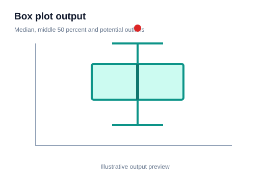
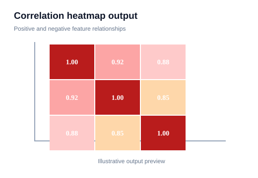
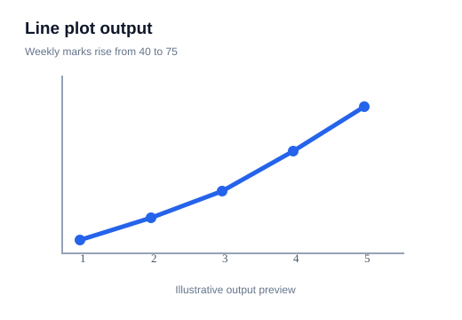
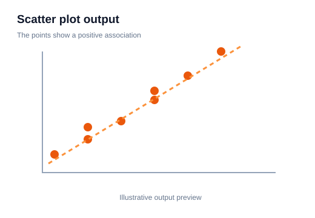

# 11 — Advanced EDA Techniques

> **Goal:** Go beyond basic plots to inspect outliers, category relationships, missingness and time patterns.

## 1. Why advanced EDA?

Basic charts show the first patterns. Advanced EDA helps investigate why patterns appear, whether they are stable and whether data quality is affecting conclusions.

## 2. Detect possible outliers with the IQR rule

The interquartile range is:

[
IQR=Q3-Q1
]

Common Tukey fences are:
[
Lower=Q1-1.5\times IQR
]
[
Upper=Q3+1.5\times IQR
]

```python
Q1 = df["Marks"].quantile(0.25)
Q3 = df["Marks"].quantile(0.75)
IQR = Q3 - Q1

lower = Q1 - 1.5 * IQR
upper = Q3 + 1.5 * IQR

possible_outliers = df[
    (df["Marks"] < lower) | (df["Marks"] > upper)
]
```

This identifies possible outliers, not guaranteed errors. Use domain knowledge to investigate them.

## 3. Compare distributions by category

```python
import seaborn as sns
import matplotlib.pyplot as plt

sns.boxenplot(data=df, x="Department", y="Marks")
plt.show()
```

**Visual output preview**



**What to notice:** Compare the median and spread. Distant points can be possible outliers and should be investigated.

A boxen plot can display more distribution detail for larger datasets. A box plot or violin plot may be easier for smaller samples.

## 4. Category relationships with crosstab

```python
table = pd.crosstab(df["Department"], df["Result"])
sns.heatmap(table, annot=True, fmt="d", cmap="Blues")
plt.show()
```

**Visual output preview**



**What to notice:** Compare cell colours and annotations to find stronger and weaker relationships or category combinations.

This displays counts for each department-result combination. Normalize counts when groups have very different sizes.

## 5. Missingness pattern

```python
missing = df.isna().astype(int)
sns.heatmap(missing, cbar=False)
plt.title("Missingness Pattern")
plt.show()
```

**Visual output preview**


**What to notice:** Compare cell colours and annotations to find stronger and weaker relationships or category combinations.

Rows and columns reveal where values are missing. A pattern may suggest that missingness is related to a collection process or subgroup. A heatmap alone cannot establish the reason.

## 6. Time-series exploration

For time-based data:
1. Convert the date column to datetime.
2. Sort chronologically.
3. Set the date as the index if useful.
4. Plot the series.
5. Examine trend, seasonality and unusual periods.

```python
df["Date"] = pd.to_datetime(df["Date"])
df = df.sort_values("Date")

fig, ax = plt.subplots()
ax.plot(df["Date"], df["Sales"])
ax.set_xlabel("Date")
ax.set_ylabel("Sales")
plt.show()
```

**Visual output preview**



**What to notice:** Follow the line across the x-axis to understand the trend, peaks and changes over time.

## 7. Rolling averages

A rolling average smooths short-term variation:

```python
df["Rolling_7"] = df["Sales"].rolling(window=7, min_periods=1).mean()
```

A rolling window of 7 uses the current observation and up to six preceding observations. For daily data, this can represent a 7-observation moving average; check whether missing dates affect the interpretation.

## 8. Pairwise relationships and nonlinear patterns

A scatter plot with a smooth trend can reveal nonlinear relationships. A correlation coefficient may be near zero even when a strong curved pattern exists.

```python
sns.regplot(data=df, x="Feature", y="Target", lowess=True)
plt.show()
```

**Visual output preview**



**What to notice:** Each point is an observation. Look for direction, clusters, unusual points or a curved relationship.

LOWESS is a locally weighted smoothing method. It is exploratory and should not be mistaken for a validated predictive model.

## 9. Segment analysis

Compare a key metric across meaningful groups, such as:
- customer age bands,
- geographic regions,
- product categories,
- student departments,
- months or seasons.

Check sample sizes for each segment. A large average difference based on only two observations may be unstable.

## 10. Common mistakes

- Treating statistical outlier rules as automatic deletion rules.
- Comparing raw counts across unequal group sizes.
- Smoothing a time series without considering ordering and missing dates.
- Interpreting missingness patterns as proof of a cause.
- Overfitting a story to random visual patterns.

## 11. Practice

For a sales or student dataset:
1. Identify possible outliers with IQR.
2. Visualize missingness.
3. Create a category crosstab heatmap.
4. Plot a time series and rolling average if dates exist.
5. Compare a metric across meaningful segments.
6. Document which findings require further validation.

**Checkpoint:** Advanced EDA should produce testable questions and better data understanding—not unsupported conclusions.
