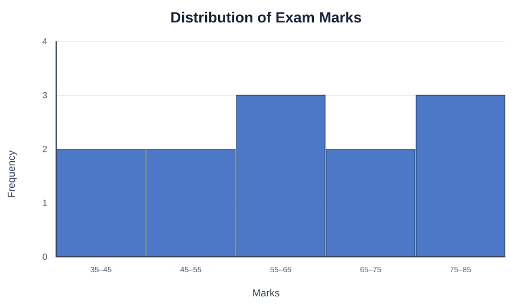
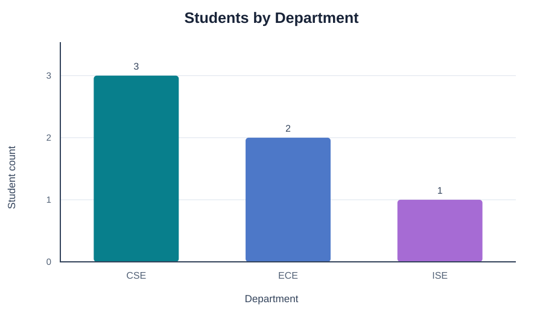
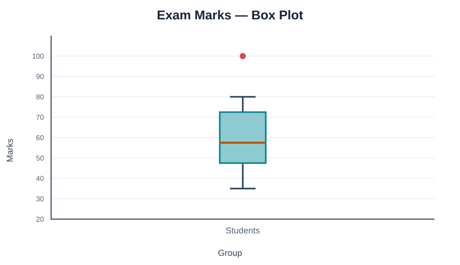
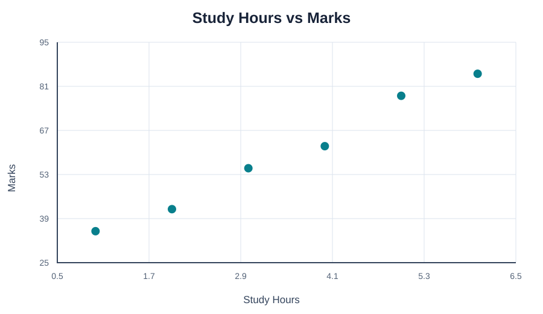
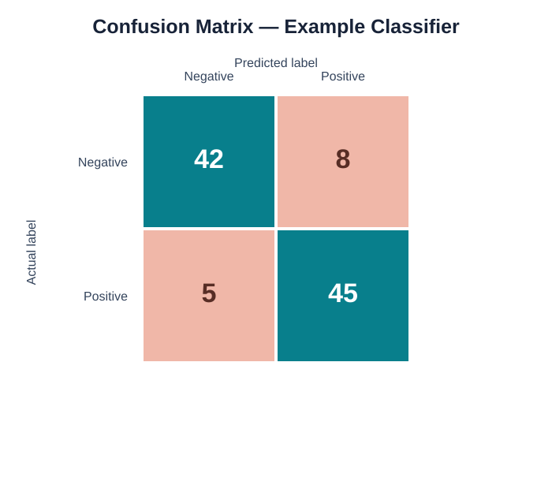
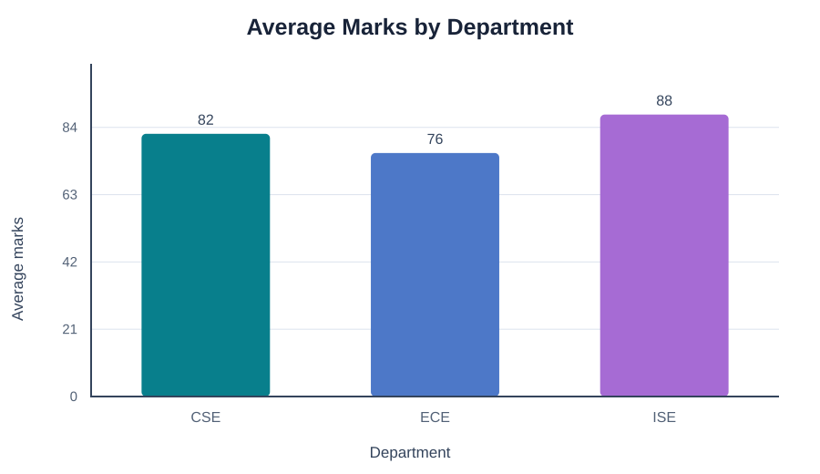

# 12 — Data Visualization for Machine Learning

> **Goal:** Use plots to understand features, targets, model errors and model behavior without confusing exploration with proof.

## 1. Why visualize in ML?

Visualization supports the machine-learning workflow:
- understand the target distribution,
- inspect feature distributions,
- find possible outliers,
- explore relationships,
- compare classes,
- inspect prediction errors,
- communicate model behavior.

Plots help diagnose and explain; they do not replace proper validation metrics.

## 2. Understand the target

For regression, inspect the target distribution:

```python
sns.histplot(data=df, x="Target", kde=True)
plt.show()
```

**Visual output preview**



**What to notice:** Bars show the frequency or density in each interval. Notice the overall shape and where values are concentrated.

For classification, inspect class counts:

```python
sns.countplot(data=df, x="TargetClass")
plt.show()
```

**Visual output preview**



**What to notice:** Compare the category heights and check whether the chart shows counts or a summarized value.

A highly imbalanced class distribution can affect model training and evaluation. Accuracy alone may be misleading.

## 3. Feature distributions and outliers

```python
sns.histplot(data=df, x="Feature1", kde=True)
sns.boxplot(data=df, x="Feature1")
plt.show()
```

**Visual output preview**


**What to notice:** Bars show the frequency or density in each interval. Notice the overall shape and where values are concentrated.

**Visual output preview**



**What to notice:** Compare the median and spread. Distant points can be possible outliers and should be investigated.

Check whether values are skewed, contain unusual ranges or require transformations. Outliers are not automatically errors.

## 4. Feature relationships

```python
sns.scatterplot(data=df, x="Feature1", y="Feature2", hue="TargetClass")
plt.show()
```

**Visual output preview**



**What to notice:** Each point is an observation. Look for direction, clusters, unusual points or a curved relationship.

This may reveal clusters or class separation. If many points overlap, use transparency or a sampling strategy.

## 5. Confusion matrix for classification

A confusion matrix compares true labels with predicted labels:

```python
from sklearn.metrics import confusion_matrix, ConfusionMatrixDisplay

cm = confusion_matrix(y_test, y_pred)
ConfusionMatrixDisplay(confusion_matrix=cm).plot()
plt.show()
```

**Visual output preview**



**What to notice:** The diagonal shows correct predictions; off-diagonal cells show misclassifications.

**Visual output preview**


**What to notice:** Predictions closer to the diagonal are closer to the actual values.

For binary classification:
- true positive: positive correctly predicted,
- true negative: negative correctly predicted,
- false positive: negative incorrectly predicted as positive,
- false negative: positive incorrectly predicted as negative.

The order of labels and the positive class should be stated clearly.

## 6. Regression residual plot

A residual is:
[
Residual = Actual - Predicted
]

```python
residuals = y_test - y_pred

plt.scatter(y_pred, residuals)
plt.axhline(0, linestyle="--")
plt.xlabel("Predicted")
plt.ylabel("Residual")
plt.title("Residual Plot")
plt.show()
```

**Visual output preview**


**What to notice:** Each point is an observation. Look for direction, clusters, unusual points or a curved relationship.

**Visual output preview**



**What to notice:** Look for a random band around zero. A curve or changing spread may indicate model errors.

A pattern in residuals may suggest nonlinearity, changing variance or missing structure. A random cloud around zero is often desirable, but it is not the only diagnostic.

## 7. Actual versus predicted

```python
plt.scatter(y_test, y_pred)
plt.xlabel("Actual")
plt.ylabel("Predicted")
plt.title("Actual vs Predicted")
plt.show()
```

**Visual output preview**


**What to notice:** Each point is an observation. Look for direction, clusters, unusual points or a curved relationship.

**Visual output preview**


**What to notice:** Predictions closer to the diagonal are closer to the actual values.

Perfect predictions would lie on the diagonal (y=x). Add a reference line when the axes share comparable scales.

## 8. Learning curves

A learning curve compares model performance as training data size increases. It can help diagnose high bias, high variance or whether more training data may help.

Scikit-learn provides tools such as `learning_curve`. Always distinguish training score from cross-validation score.

## 9. Feature importance and caution

Some models provide feature importance values. A bar chart can show their relative importance, but importance is model-dependent and does not automatically imply causation. Correlated features can share or distort importance.

For more robust interpretation, consider permutation importance or model-agnostic explanation tools, while respecting validation data.

## 10. Avoid data leakage during visualization and modeling

Exploratory plots can be made on training data, but do not use test-set information to choose preprocessing parameters or repeatedly tune a model. Keep the final test set for an unbiased evaluation after decisions are complete.

## 11. Common mistakes

- Using accuracy alone for imbalanced classification.
- Misreading confusion-matrix axes.
- Assuming residuals must be exactly zero.
- Treating feature importance as causal evidence.
- Tuning repeatedly on the test set.
- Drawing conclusions from training performance alone.

## 12. Practice

Train a simple regression or classification model and create:
1. Target distribution plot.
2. Feature histogram and box plot.
3. Correlation heatmap for numeric features.
4. Confusion matrix (classification) or actual-vs-predicted plot (regression).
5. Residual plot for regression.
6. A short explanation of what each plot reveals and what it cannot prove.

**Checkpoint:** Visualization is a diagnostic partner to ML metrics. Use it to ask better questions, then validate those questions with sound evaluation.
