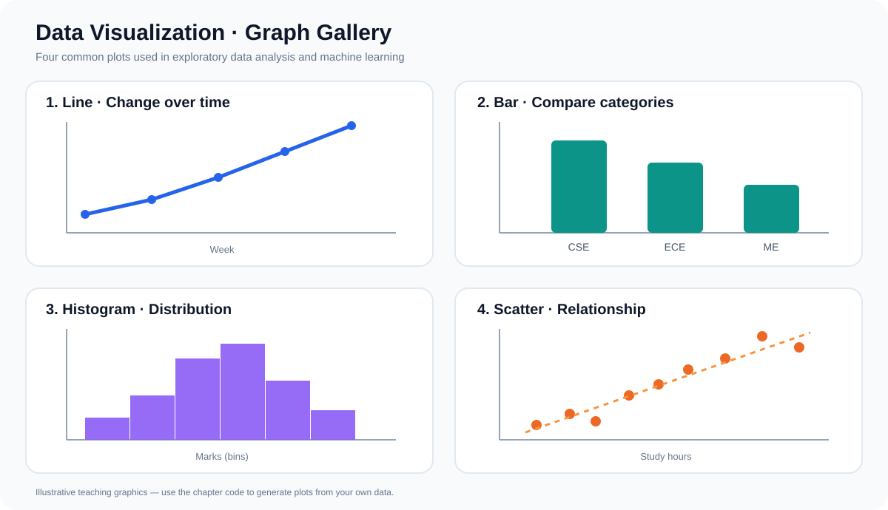
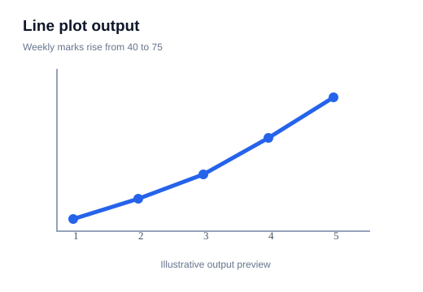
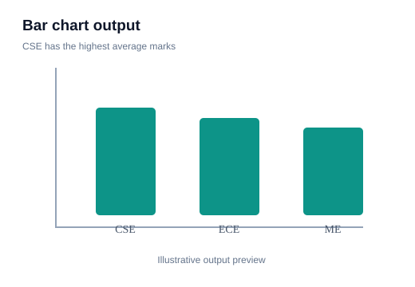
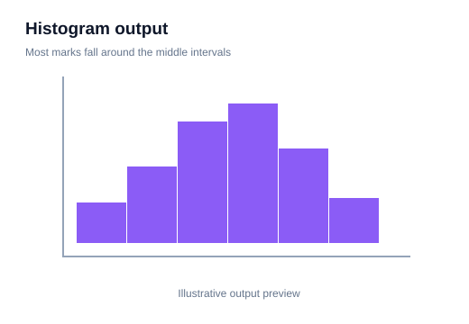
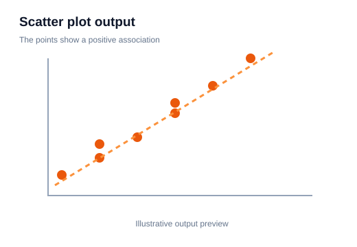
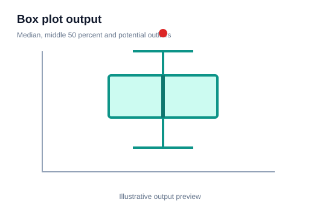
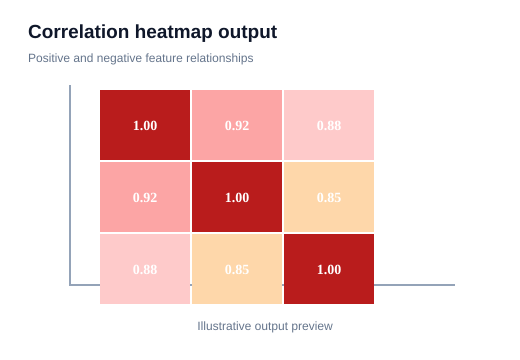
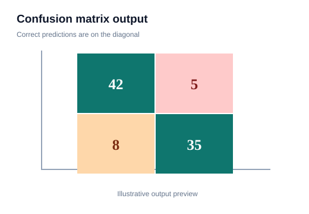
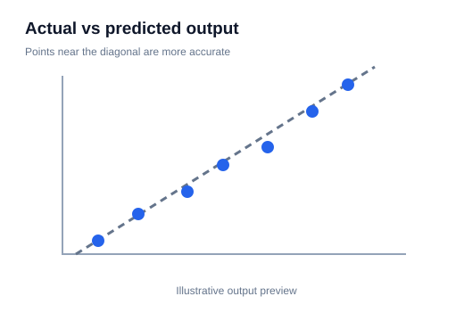
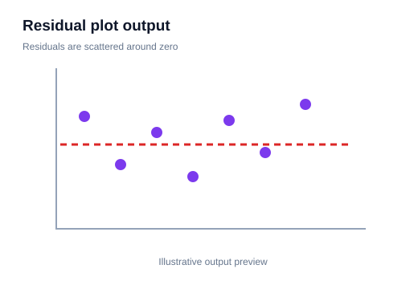

# 13 — Graph Gallery: Read the Plot, Understand the Data

> 🟣 **VISUAL LEARNING LAB** · Learn which graph to choose, how to create it and what the output tells you.

A graph is useful when you can explain its axes, patterns and values. The gallery below gives you a quick visual reference.

## 1. Line plot — change over time

**Question:** How did marks change across weekly tests?

~~~python
import matplotlib.pyplot as plt

weeks = [1, 2, 3, 4, 5]
marks = [40, 48, 55, 63, 75]

plt.plot(weeks, marks, marker="o")
plt.title("Marks Across Weekly Tests")
plt.xlabel("Week")
plt.ylabel("Marks")
plt.grid(alpha=0.3)
plt.show()
~~~

**How to read it:** x-axis = week; y-axis = marks. The upward line shows marks increased in this example.

**ML use:** training loss across epochs, time trends and sequential measurements.

## 2. Bar chart — compare categories

**Question:** Which department has the highest average score?

~~~python
departments = ["CSE", "ECE", "ME"]
average_marks = [72, 65, 58]

plt.bar(departments, average_marks)
plt.title("Average Marks by Department")
plt.xlabel("Department")
plt.ylabel("Average Marks")
plt.show()
~~~

**How to read it:** each bar is a category. Taller bars mean larger values. CSE has the highest average here.

**ML use:** category counts and comparing model scores.

## 3. Histogram — understand a distribution

**Question:** Where are most student marks concentrated?

~~~python
marks = [35, 40, 45, 48, 50, 52, 55, 58, 60, 62,
         65, 68, 70, 72, 75, 78, 80, 85, 88, 92]

plt.hist(marks, bins=5, edgecolor="black")
plt.title("Distribution of Student Marks")
plt.xlabel("Marks")
plt.ylabel("Number of Students")
plt.show()
~~~

**How to read it:** x-axis contains mark intervals (bins); y-axis shows the number of observations in each interval.

**ML use:** inspect feature distributions, skewness, unusual ranges and possible multiple peaks.

## 4. Scatter plot — inspect relationships

~~~python
hours = [1, 2, 2, 3, 4, 4, 5, 6]
marks = [35, 42, 48, 50, 60, 65, 72, 85]

plt.scatter(hours, marks)
plt.title("Study Hours vs Marks")
plt.xlabel("Study Hours")
plt.ylabel("Marks")
plt.show()
~~~

**How to read it:** each dot is one student. The upward pattern suggests a positive association in this small sample. Correlation does not prove causation.

**ML use:** relationships between numeric features, clusters and nonlinear patterns.

## 5. Box plot — spread and possible outliers

~~~python
class_a = [45, 50, 52, 55, 58, 60, 62, 65, 68]
class_b = [30, 42, 50, 55, 60, 70, 82, 90, 98]

plt.boxplot([class_a, class_b], labels=["Class A", "Class B"])
plt.title("Marks Spread by Class")
plt.ylabel("Marks")
plt.show()
~~~

**How to read it:**
- Middle line = median.
- Box = middle 50% of values (Q1 to Q3).
- Whiskers = range allowed by the box-plot rule.
- Points beyond whiskers = possible outliers.

An outlier is not automatically an error. Investigate before removing it.

## 6. Correlation heatmap — compare numeric features

~~~python
import pandas as pd
import seaborn as sns

data = pd.DataFrame({
    "Hours": [1, 2, 3, 4, 5],
    "Attendance": [60, 65, 75, 85, 95],
    "Marks": [35, 42, 55, 68, 82]
})

corr = data.corr(numeric_only=True)
sns.heatmap(corr, annot=True, cmap="coolwarm", vmin=-1, vmax=1)
plt.title("Feature Correlation Heatmap")
plt.show()
~~~

**How to read it:** correlation ranges from -1 to +1.

| Value | Meaning |
|---:|---|
| +1 | Perfect positive linear relationship |
| 0 | No linear relationship |
| -1 | Perfect negative linear relationship |

Correlation does not prove causation and may miss nonlinear relationships.

## 7. Confusion matrix — classification results

~~~python
from sklearn.metrics import ConfusionMatrixDisplay

ConfusionMatrixDisplay.from_predictions(y_test, y_pred)
plt.title("Confusion Matrix")
plt.show()
~~~

It compares actual classes with predicted classes and helps identify false positives and false negatives.

## 8. Actual versus predicted — regression results

~~~python
plt.scatter(y_test, y_pred)
low = min(y_test.min(), y_pred.min())
high = max(y_test.max(), y_pred.max())
plt.plot([low, high], [low, high], linestyle="--")
plt.xlabel("Actual")
plt.ylabel("Predicted")
plt.title("Actual vs Predicted")
plt.show()
~~~

Points close to the diagonal represent predictions close to actual values.

## 9. Residual plot — inspect model errors

~~~python
residuals = y_test - y_pred
plt.scatter(y_pred, residuals)
plt.axhline(0, linestyle="--")
plt.xlabel("Predicted")
plt.ylabel("Residual")
plt.title("Residual Plot")
plt.show()
~~~

Residual = actual − predicted. Patterns may reveal issues that a single error score hides.

## 10. Which graph should I choose?

| Question | Graph |
|---|---|
| Change over time? | Line |
| Compare categories? | Bar |
| Distribution of numeric values? | Histogram |
| Relationship between two numeric features? | Scatter |
| Spread and possible outliers? | Box |
| Relationships across many numeric features? | Heatmap |
| Classification performance? | Confusion matrix |
| Regression predictions? | Actual vs predicted and residual |

## Good graph habits

- Label axes and add a meaningful title.
- Select the graph based on the question.
- Use readable scales.
- Use transparency when scatter points overlap.
- Investigate outliers before removing them.
- Do not repeatedly tune a model using the final test set.

**Practice:** Use a student dataset to create a histogram, department bar chart, study-hours scatter plot, box plot and numeric correlation heatmap. Write one sentence explaining what each graph reveals.

**Checkpoint:** You are learning data visualization for EDA and ML when you can explain what question a graph answers—not just remember its syntax.
