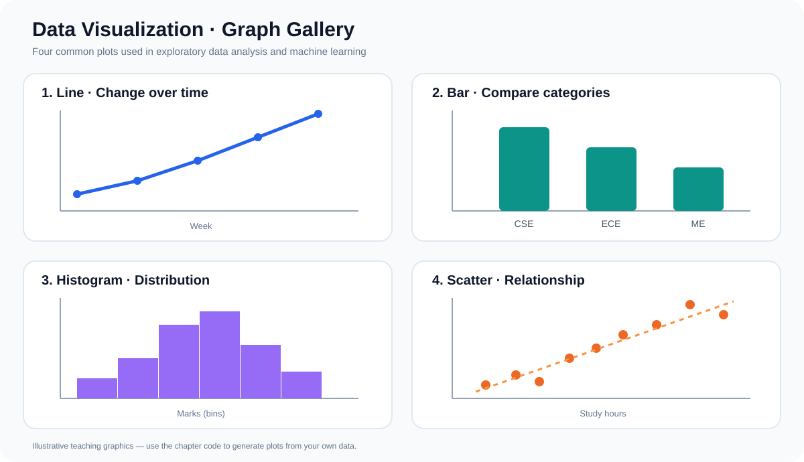

# Data Visualization — Master Notes

Use Matplotlib and Seaborn to understand data and model behaviour.

## Chapter index

| # | Chapter | Priority |
|---:|---|---|
| 01 | [Visualization Fundamentals](01-Visualization-Fundamentals.md) | Core |
| 02 | [Matplotlib Fundamentals](02-Matplotlib-Fundamentals.md) | Core |
| 03 | [Line and Scatter Plots](03-Line-and-Scatter-Plots.md) | Core |
| 04 | [Bar and Count Plots](04-Bar-and-Count-Plots.md) | Core |
| 05 | [Histograms and Distributions](05-Histograms-and-Distributions.md) | Core |
| 06 | [Box and Violin Plots](06-Box-and-Violin-Plots.md) | Core |
| 07 | [Figure, Axes and Subplots](07-Figure-Axes-and-Subplots.md) | Core |
| 08 | [Seaborn Fundamentals](08-Seaborn-Fundamentals.md) | Core |
| 09 | [Correlation and Heatmaps](09-Correlation-and-Heatmaps.md) | Core |
| 10 | [Pairplots and EDA](10-Pairplots-and-EDA.md) | Core |
| 11 | [Advanced EDA Techniques](11-Advanced-EDA-Techniques.md) | Core |
| 12 | [Visualization for ML](12-Visualization-for-ML.md) | Core |
| 13 | [Graphs with Real Examples](13-Graphs-with-Real-Examples.md) | **Visual practice** |

## Visual learning format

Practical plotting examples include an output preview directly below the code, followed by a short note explaining what to notice in the chart. Use the previews to connect Python commands with the graph they create.

## Graph preview

## Revision focus

- Select a chart based on the question
- Understand distributions and relationships
- Compare groups and detect unusual values
- Diagnose model errors with suitable plots
- Explain what a graph reveals in plain language

[← Back to Master Notes](../README.md)
